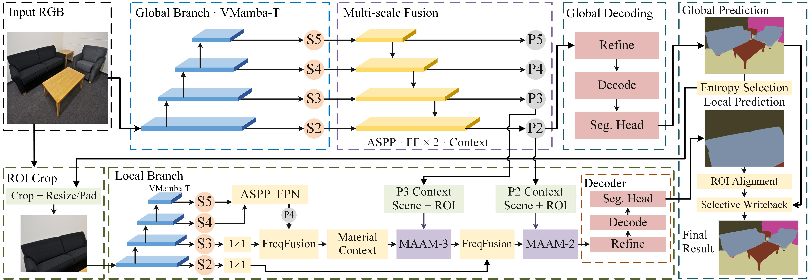

<h1 align="center">Object Material Perception via Multi-Scale Feature Fusion and Multi-Supervision Optimization</h1>

 
Dapeng Chen, Juncheng Lou, Hao Wu, Lina Wei, Chengcheng Hua, and Jia Liu
  
  
Nanjing University of Information Science and Technology

---

<h2 align="center">ABSTRACT</h2>  
Image material perception aims to achieve pixel-level recognition of the surface materials of objects in an image and is a key step toward fine-grained visual understanding. To improve material perception accuracy and boundary quality in complex real-world scenes, this paper proposes a material-aware hybrid encoding network (MAHENet). First, a global branch based on VMamba-Tiny (VMamba-T) extracts full-image features and selects local regions according to prediction uncertainty, while a local expert extracts detailed features. To further enhance local material discrimination, we construct a material-aware attention module (MAAM) with dual-context guidance. Using local features as queries, this module attends to scene features from the full image and global features of the corresponding region, and establishes spatial correspondence through original-image coordinate encoding. A multi-scale feature fusion module based on a feature pyramid then integrates deep semantic information and shallow details. Finally, an edge-enhanced decoder reconstructs segmentation maps with clear boundaries and rich details under auxiliary supervision. After spatial alignment, local predictions are selectively written back to the global prediction to obtain the final result. On the test set covering 37 material categories of the public Dense Material Segmentation (DMS) dataset, MAHENet achieves a mean class pixel accuracy (mAcc) of 73.20%, a mean intersection over union (mIoU) of 62.30%, an overall pixel accuracy (PAcc) of 84.22%, and a boundary F1 score (BF1) of 72.54%, demonstrating competitive overall performance.

  
  
